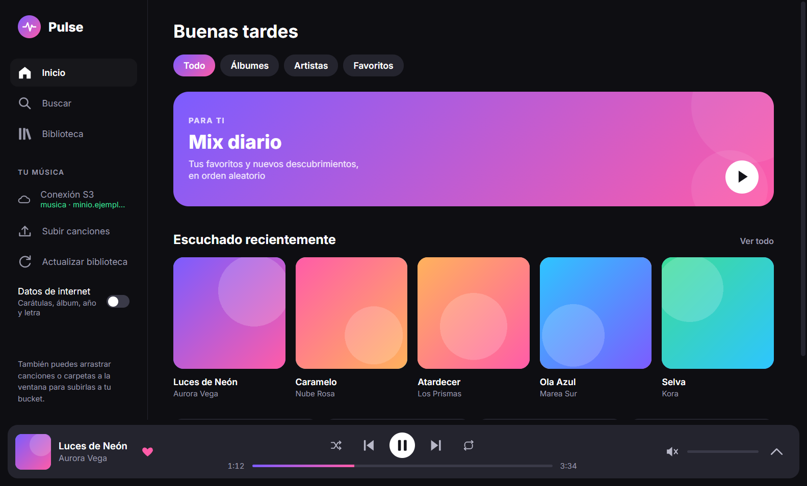
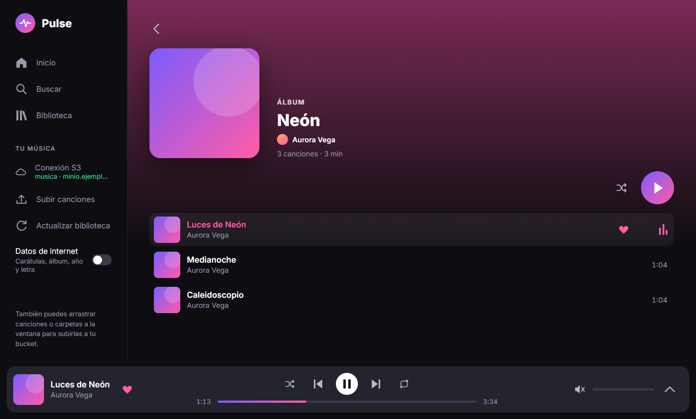
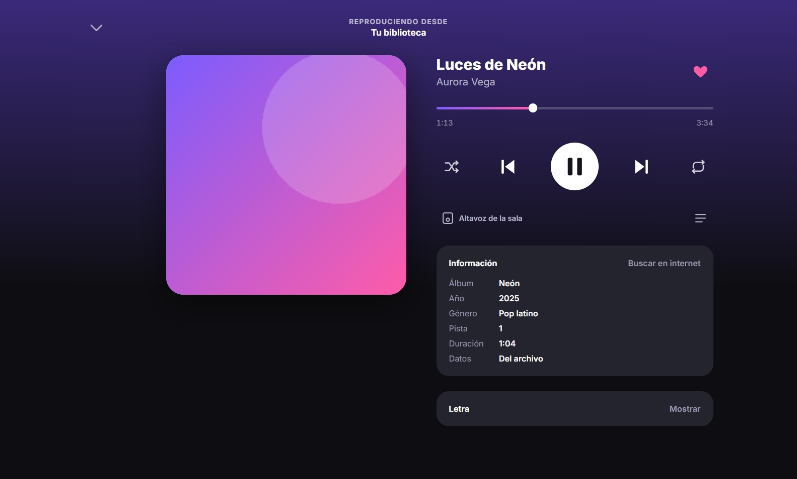
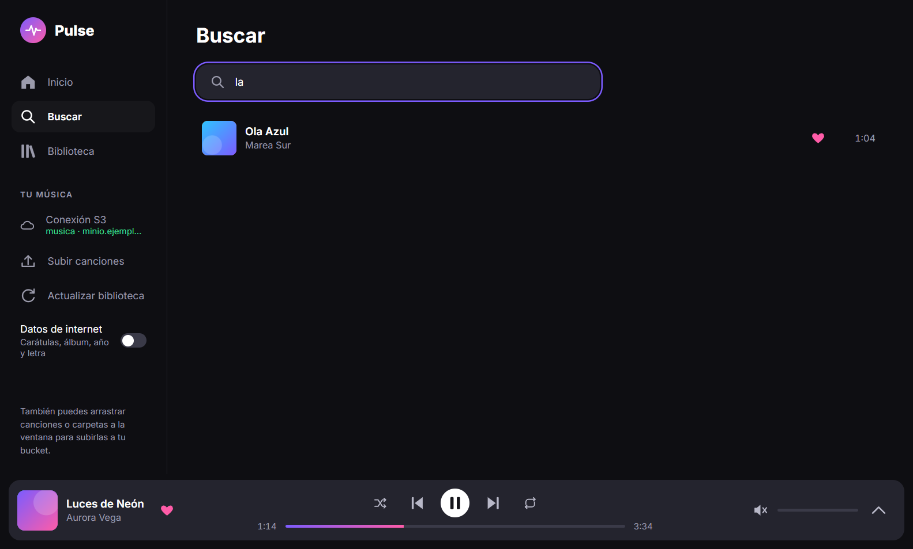
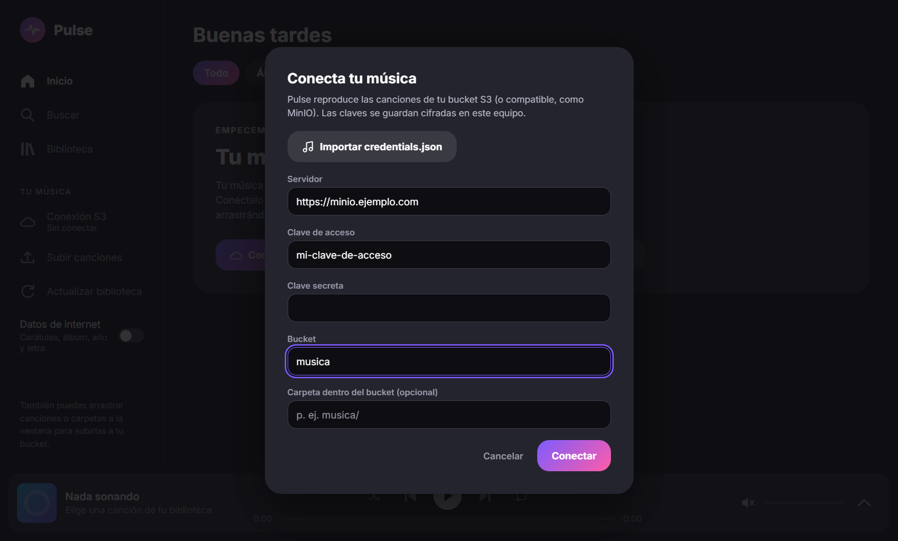
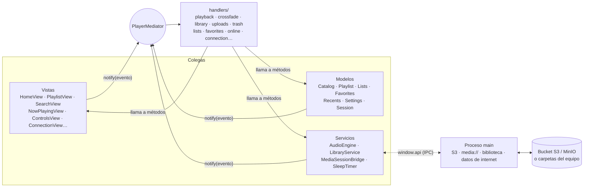

<div align="center">


# Pulse

**Tu música en tu propio bucket S3 (o en tus carpetas), con un reproductor bonito para el ordenador y el móvil.**

Reproductor para Windows y Linux (Electron) y Android (Capacitor), hecho con JavaScript puro, sin frameworks de UI.
Por dentro está organizado con el patrón **Mediator**.




</div>

---

## ✨ Qué hace

- ☁️ **Tu biblioteca es tu bucket.** Conecta un bucket de S3 o de un servicio compatible, como MinIO, y Pulse
  reproduce lo que haya en él, en streaming y con saltos instantáneos (peticiones por rangos).
- 📁 **O tus carpetas.** En vez del bucket, puedes elegir carpetas del ordenador o del móvil. Pulse solo las lee:
  nunca sube, mueve ni borra esos archivos, y tus listas y favoritos se quedan en ese equipo.
- ⬆️ **Sube canciones** con un botón o arrastrando archivos y carpetas a la ventana. Nunca sobrescribe nada: si
  la canción ya está, se salta; si hay otra con el mismo nombre, se guarda como «Nombre (2)».
- 🗑️ **Papelera.** «Eliminar del bucket» no borra al momento: la canción va a `papelera/` y desaparece de todos tus
  Pulse. Desde «Papelera» la restauras o la borras para siempre.
- 🔄 **Siempre al día.** La biblioteca se sincroniza al arrancar, al volver a la ventana y cuando pulsas
  «Actualizar biblioteca». Lo nuevo, lo cambiado y lo borrado aparece o desaparece solo.
- 🗂️ **Los metadatos también viven en el bucket**, en `metadatos/`. Si abres Pulse en otro equipo, encuentras las
  mismas carátulas, los mismos datos y las mismas letras, sin repetir búsquedas.
- 🌐 **Datos de internet**: carátula, álbum, año, género, número de pista y letra, tomados de
  [iTunes Search](https://performance-partners.apple.com/search-api), [Deezer](https://developers.deezer.com/api)
  y [LRCLIB](https://lrclib.net). Son servicios gratuitos y sin clave. Pulse **solo rellena huecos**: nunca pisa
  las etiquetas de tus archivos y prefiere no encontrar nada antes que poner datos equivocados (rechaza remixes,
  directos, otros artistas o duraciones que no encajan).
- 🎤 **Letra sincronizada**: en Reproduciendo se resalta el verso que suena y, al pulsar uno, la canción salta a él.
- 🎚️ **Sin cortes entre canciones** y con **fundido** opcional (0–8 s, en la barra lateral).
- 🎛️ **Ecualizador** de cinco bandas con preajustes (en el ordenador).
- 📈 **Más escuchadas, Sin escuchar y Añadidas recientemente**: listas que se hacen solas con lo que escuchas en todos tus equipos.
- 🖥️ **Bandeja del sistema** con la canción y los controles, botones en la miniatura de la barra de tareas (Windows) y, si quieres, **seguir sonando al cerrar la ventana**.
- 🪟 **Mini-reproductor** (Ctrl+M): una ventana pequeña y siempre encima con la canción y los controles.
- 🔄 **Se actualiza sola** en Windows y con el AppImage: descarga la versión nueva y la instala al cerrar.
- 🔉 **Igualar volumen** con las etiquetas ReplayGain de tus canciones, por pista o por disco.
- ❤️ Favoritos, listas de canciones y escuchado recientemente, **compartidos por el bucket entre todos tus equipos**.
- ✏️ **Editar los datos de una canción** (título, artista, álbum, año…) sin tocar el archivo; se ve en todos tus Pulse.
- 📄 **Exportar e importar listas M3U** (`.m3u8`): lleva una lista, un álbum o tus favoritos a otro reproductor, o trae una suya.
  Mix diario, álbumes y artistas (con su foto), y tu biblioteca ordenada y filtrada como quieras.
- 📋 **Cola editable**: reproducir a continuación, añadir a la cola, ver la cola y reordenar arrastrando (también las
  listas). Al volver a abrir Pulse, retomas donde lo dejaste.
- 🌙 Temporizador de apagado, aleatorio y repetir, búsqueda sin tildes, elección de la salida de audio y controles
  multimedia del sistema.
- 📱 **En Android**, controles en la notificación y la pantalla de bloqueo, sigue sonando con la pantalla apagada y
  puedes **descargar** listas, favoritos y álbumes para escucharlos sin conexión.
- 🔐 **Seguridad**: la clave secreta se guarda cifrada con el almacén del sistema (DPAPI en Windows, llavero en
  Linux, Keystore en Android) y en el escritorio nunca vuelve a la ventana. La ventana se ejecuta aislada (`contextIsolation`, `sandbox`, CSP estricta).

## 📸 Capturas

<table>
  <tr>
    <td width="50%"><p align="center"><b>Álbum</b></p></td>
    <td width="50%"><p align="center"><b>Reproduciendo</b>, con información y letra</p></td>
  </tr>
  <tr>
    <td width="50%"><p align="center"><b>Buscar</b></p></td>
    <td width="50%"><p align="center"><b>Conecta tu música</b> la primera vez</p></td>
  </tr>
</table>

## 📦 Descargas

Cada versión publicada en [**Releases**](https://github.com/marmol89/pulse/releases) trae los instaladores:

| Sistema | Archivo |
|---|---|
| Windows | `Pulse-Setup-X.Y.Z.exe` (instalador) |
| Linux | `pulse-X.Y.Z-x86_64.AppImage` (portable) o `pulse-X.Y.Z-amd64.deb` (Debian/Ubuntu) |
| Android | `Pulse-X.Y.Z.apk` |

> [!NOTE]
> Los instaladores no están firmados: Windows SmartScreen puede avisar la primera vez («Más información» →
> «Ejecutar de todas formas»). En Linux, al AppImage hay que darle permiso de ejecución (`chmod +x`).
> En Android, descarga el APK en el móvil y ábrelo: te pedirá permitir «instalar apps de origen desconocido».
> En Windows y con el AppImage, Pulse se actualiza solo (se instala al cerrar o con «Reiniciar ahora»); el `.deb`,
> con tu gestor de paquetes. En Android, para actualizar, instala la nueva encima. Si tenías una versión *debug* (`-debug.apk`), desinstálala antes
> una vez: la firma es distinta y Android no deja instalar encima.

## 🚀 Inicio rápido

Necesitas **Node.js 22 o posterior** y tu música (mp3, m4a, flac, ogg, wav…) en un bucket S3 o MinIO, o en carpetas
del equipo.

```bash
git clone https://github.com/marmol89/pulse.git
cd pulse
npm install
npm start
```

La primera vez se abre **«Conecta tu música»**. Para un bucket, tienes dos opciones:

1. Rellenar el formulario: servidor (`https://…`), clave de acceso, clave secreta, bucket y, si quieres, una
   carpeta dentro del bucket.
2. Pulsar **«Importar credentials.json»** y elegir el archivo que descargaste de MinIO. También acepta el estilo de
   AWS: `endpoint`, `accessKeyId`, `secretAccessKey`, `bucket`.

Si prefieres tus carpetas, ve a la pestaña **«Carpetas»** y añade las que quieras. Pulse usa el bucket o las carpetas,
nunca los dos a la vez. Puedes cambiarlo cuando quieras desde **«Conexión»**, en la barra lateral.

> [!IMPORTANT]
> Las claves **no van en el repositorio ni en el instalador**. Se guardan en tu equipo
> (`userData/s3.json`), con la clave secreta cifrada.

> [!TIP]
> Electron descarga su binario la primera vez que se usa. Si `npm start` falla al principio, fuerza la descarga
> con `node node_modules/electron/install.js`.

### Cómo queda el bucket

```
mi-bucket/
├── (carpeta opcional)/
│   ├── Artista/Álbum/01 Canción.mp3      ← tu música, organizada como quieras
│   ├── Otra canción.m4a
│   ├── metadatos/                        ← lo escribe Pulse
│   │   ├── biblioteca.json               datos de cada canción (etiquetas + internet)
│   │   ├── listas.json                   tus listas de canciones
│   │   ├── favoritos.json                tus favoritos
│   │   ├── recientes.json                escuchado recientemente
│   │   └── caratulas/<sha1>.jpg          carátulas descargadas, compartidas por álbum
│   └── papelera/                         canciones eliminadas, hasta que vacíes la papelera
```

Para leer las etiquetas, Pulse descarga solo el principio de cada archivo (512 KB, o más si la etiqueta ID3 es
grande). Si una canción deja de sonar porque la has borrado del bucket, desaparece de la biblioteca.

## ⌨️ Atajos de teclado

| Tecla | Acción |
|---|---|
| <kbd>Espacio</kbd> | Reproducir / pausar |
| <kbd>←</kbd> / <kbd>→</kbd> | Retroceder / avanzar 5 s |
| <kbd>Ctrl</kbd> + <kbd>←</kbd> / <kbd>→</kbd> | Canción anterior / siguiente |
| <kbd>Ctrl</kbd> + <kbd>↑</kbd> / <kbd>↓</kbd> | Subir / bajar volumen |
| <kbd>M</kbd> | Silenciar |
| <kbd>Ctrl</kbd> + <kbd>M</kbd> | Mini-reproductor (en el ordenador) |
| <kbd>S</kbd> | Aleatorio |
| <kbd>R</kbd> | Repetir (no / todo / una) |
| <kbd>L</kbd> | Me gusta |
| <kbd>Ctrl</kbd> + <kbd>F</kbd> | Buscar |
| <kbd>Esc</kbd> | Cerrar Reproduciendo |
| <kbd>Alt</kbd> + <kbd>↑</kbd> / <kbd>↓</kbd> | Mover la canción con el foco en una lista o en la cola |

## 🔒 Privacidad

Para buscar los datos que faltan, Pulse envía **el título y el artista** de la canción a iTunes, Deezer y LRCLIB
(y el nombre del artista a Deezer, para su foto).
Nada más: ni tus archivos ni tus claves. Todas las peticiones salen del proceso principal; la ventana nunca se
conecta a internet. Si no quieres que se envíe nada, desactiva **«Datos de internet»** en la barra lateral.

Lo encontrado se guarda en tu bucket y en una caché local, así que funciona sin conexión.

## 🧩 Arquitectura: patrón Mediator

Las piezas de la interfaz (los **colegas**) no se conocen entre sí. Cada una expone sus métodos y avisa de lo que
pasa con `notify(evento)`. El **mediador** recibe el aviso y lo pasa a los **handlers**: un módulo por caso de
uso, sin estado y de 80 líneas como mucho. Son los handlers los que deciden qué hace cada colega.



- `PlayerMediator` **solo compone**: registra los colegas y cada módulo con `.use()`, sin `if` ni `switch`.
- `Mediator.notify()` inicia los handlers en orden, no deja que uno lento bloquee a los demás y aísla sus errores.
- Los eventos (en kebab-case, con su payload documentado) están todos en `mediator/events.js`.
- Varias de estas reglas las comprueban los tests (`tests/mediator/rules.test.js`), así que romper el patrón hace
  fallar la suite.

### Estructura

```
src/
├── backend/              lógica común a escritorio y Android (sin Node ni Electron)
│   ├── s3/               cliente S3 y conexión con la clave secreta cifrada
│   ├── library/          sincronización, subidas, papelera, metadatos/, listas, favoritos, recientes, caché local
│   └── online/           iTunes, Deezer, LRCLIB, emparejado y cola en segundo plano
├── main/                 Electron (fuera del mediador): ventana, archivos, carpetas, media:// con rangos, ipc/
├── preload/preload.cjs   window.api (contextBridge)
├── android/              window.api de Android: red nativa, Keystore, URLs firmadas, Media Session, descargas, carpetas
└── renderer/
    ├── app.js            raíz de composición
    ├── core/             Mediator y Colleague
    ├── mediator/         PlayerMediator, events.js, actions.js y handlers/
    ├── colleagues/       modelos, servicios y vistas
    ├── ui/ · lib/        piezas de UI sin estado y utilidades puras
    └── styles/           tokens.css (único sitio con valores), layout.css, components.css
tests/                    unitarios por carpeta, helpers (S3 falso, WAV con ID3…) y e2e/
```

## 🛠️ Comandos

| Comando | Qué hace |
|---|---|
| `npm start` | Arranca la app en desarrollo |
| `npm test` | Tests unitarios (`node:test`) |
| `npm run test:e2e` | Prueba de humo de la app real (playwright-core) contra un **S3 falso**, con capturas en `tests/e2e/output/` |
| `npm run icons` | Regenera `src/assets/icon.png` y los iconos de Android |
| `npm run dist:win` | Instalador NSIS para Windows en `dist/` |
| `npm run dist:linux` | AppImage y `.deb` en `dist/` (mejor desde Linux, WSL o CI) |
| `npm run android:apk` | APK de Android en `dist/` (necesita JDK 21 y el SDK de Android: `JAVA_HOME`, `ANDROID_HOME`) |
| `npm run android:release` | APK firmado con tu keystore (`PULSE_KEYSTORE`, `PULSE_KEYSTORE_PASSWORD`, `PULSE_KEY_ALIAS`, `PULSE_KEY_PASSWORD`) |
| `npm run android:bundle` | App Bundle (`.aab`) firmado, el que se sube a Google Play |
| `npm run test:e2e:android` | Prueba de humo del APK instalado en un emulador, contra el S3 falso |

Para publicar no hace falta compilar en local: lo hace GitHub Actions al sacar cada versión (ver
«Versiones», más abajo).

Los tests **nunca** usan un S3 real ni servicios de internet: `tests/helpers/fakeS3.js` es un servidor S3 mínimo y
las búsquedas usan un `fetch` falso.

## 🤝 Contribuir

- `main` solo acepta cambios **por pull request**, revisados por el admin del repositorio. Crea una rama, haz tus
  cambios y abre la PR.
- Commits pequeños (uno por pieza) en español, con [Conventional Commits](https://www.conventionalcommits.org/es/):
  `feat(ui): …`, `fix(online): …`, `docs: …`.
- Para añadir una funcionalidad: si hace falta, un colega nuevo en `colleagues/`; sus eventos en `events.js`; y un
  **módulo nuevo** en `mediator/handlers/` registrado con `.use()`, con su test en `tests/handlers/`.
- En CSS, colores, radios y tamaños de fuente solo con los tokens de `tokens.css`. Nada de `innerHTML` con datos de
  archivos: usa `h()` de `ui/dom.js`.
- Antes de abrir la PR, ejecuta `npm test` y, si tocas la interfaz o el proceso principal, también
  `npm run test:e2e`. Si cambias la interfaz, revisa las capturas de escritorio y de móvil; en el móvil, nada de
  varios botones en una fila: un solo «⋯» con las opciones.

### 🏷️ Versiones

Las versiones siguen [SemVer](https://semver.org/lang/es/) y las prepara
[release-please](https://github.com/googleapis/release-please) a partir de los commits:

1. Cada cambio que entra en `main` se acumula en una PR **«chore: versión X.Y.Z»**, que sube la versión de
   `package.json` y escribe el [`CHANGELOG.md`](CHANGELOG.md). Un `feat` sube la versión menor (0.1.0 → 0.2.0) y
   un `fix`, el parche (0.1.0 → 0.1.1).
2. Solo el admin del repositorio la aprueba. Al fusionarla se crea la etiqueta `vX.Y.Z` con su release, y GitHub
   Actions compila y adjunta los instaladores de Windows y Linux y el APK de Android, y sube el App Bundle a la
   prueba interna de Google Play.
3. Los commits siguientes abren la PR de la versión siguiente. La primera versión es la **0.1.0**.

Para probar la compilación sin publicar nada: pestaña **Actions** → **Instaladores** → **Run workflow**.

<div align="center">
<sub>Hecho con ♪ y JavaScript puro.</sub>
</div>
